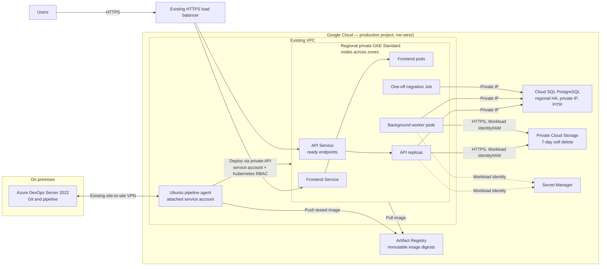

# Corrected system architecture

Proposed target design; not deployed. Managed services are shown outside the VPC boundary.

The agent connects to Azure DevOps over the existing VPN, pushes to Artifact Registry, and deploys through the private GKE API. GKE pods use Workload Identity; no service-account key files are used. Cloud SQL is reached over private IP; Cloud Storage is a Google-managed service outside the VPC, accessed by authenticated API calls rather than as a VPC resource.

Regional GKE capacity and Cloud SQL HA target a single-zone failure. PITR and bucket soft delete address recovery, not availability. All have cost/quota implications; regional disaster recovery is out of scope.
