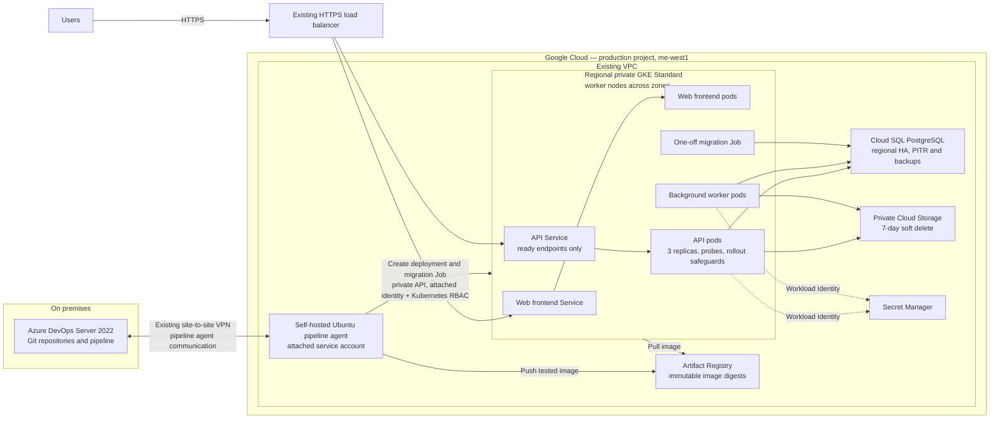

# Corrected system architecture

This is the proposed target topology for the assignment, not a deployed system. The diagram keeps Azure DevOps Server as Git and CI/CD, preserves the existing VPN/HTTPS/identity setup, and shows the minimum single-zone resilience and recovery controls described in the solution.

### Paths and boundaries

- User traffic enters through the existing HTTPS load balancer and reaches the frontend and API; Services send API traffic only to ready pods.
- The on-premises Azure DevOps Server communicates with the GCP-resident agent over the existing VPN. The agent checks out code and runs validation/build/deployment jobs. Its attached service account is scoped to push to Artifact Registry and reach the private GKE API; Kubernetes RBAC limits deployment permissions. It has no service-account key file.
- GKE retrieves the recorded image from Artifact Registry. Application pods use Workload Identity for required Google Cloud access and Secret Manager for secrets; they connect to Cloud SQL over private IP and use the private bucket for uploaded objects.
- Cloud SQL regional HA addresses a single-zone failure; PITR/backups address database recovery. Bucket soft delete addresses accidental object deletion. These controls have separate purposes and are not substitutes for one another.

The regional cluster and database standby, plus retained database logs and deleted object generations, have cost and quota implications. Capacity and restore time must be validated; the proposal does not claim regional disaster recovery.
