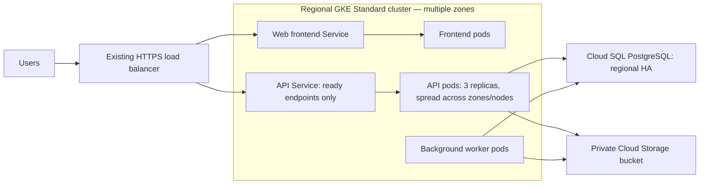

# Problem 1 — Service availability

## Cause and risk

The API has a single replica, so a restart, rollout, or node drain can remove every API backend. Without startup and readiness probes, Kubernetes and the load balancer cannot reliably distinguish a starting or unhealthy process from one ready to serve. With no resource requests or limits, scheduling and resource contention are unpredictable. The two nodes and single-zone Cloud SQL instance also share a zone failure domain.

## Safer releases and node maintenance

The example in [`snippets/api-deployment.yaml`](snippets/api-deployment.yaml) assumes the API runs on a multi-zone GKE cluster with enough node capacity to place three replicas. Replace its image and namespace placeholders, and tune the sample resource values using measurements before applying it.

Important settings:

- **Three replicas and topology spread:** keep API capacity across zones and nodes instead of putting every replica in one failure domain. To place one replica in each of three zones, provide eligible nodes and capacity in all three; with fewer zones, replicas can still spread across the available zones, but zone resilience is reduced. If hard constraints prevent scheduling in the actual cluster, adjust them deliberately rather than leaving pods Pending.
- **Startup, readiness, and liveness probes:** startup gives initialization time before other probes run; readiness keeps starting or unready pods out of Service endpoints; liveness restarts a stuck process. Implement these lightweight endpoints in the API. Liveness should check the process, not PostgreSQL, to avoid restart storms during a database incident. Readiness may check essential dependencies without making expensive calls.
- **Rolling update with `maxUnavailable: 0`:** keep the old ready capacity while a replacement starts. `maxSurge: 1` allows a temporary extra pod. Kubernetes waits for readiness before considering a replacement available.
- **PodDisruptionBudget (`minAvailable: 2`):** limits voluntary disruptions such as node drains so at least two API pods remain available. It does not prevent involuntary failures or replace adequate capacity.
- **Requests and limits:** requests support scheduling and reserve a baseline; limits cap resource consumption. The values shown are starting examples, not measured production sizing.
- **Graceful termination:** allow up to 60 seconds for the application to handle `SIGTERM`, stop accepting new requests, and drain in-flight work. Configure the server's shutdown timeout to fit inside this period.

### Safe rollout and verification

1. Implement and locally test the health endpoints and graceful `SIGTERM` handling. Confirm a dependency outage does not make liveness fail.
2. Before applying the hard topology constraints, provide eligible nodes and enough capacity in the intended zones. In a non-production cluster, apply the manifest and wait for all three replicas to become Ready.
3. Roll out a harmless new image while continuously sending requests. Verify requests continue, the new pod becomes Ready before an old one is removed, and a deliberately failing readiness probe is not sent traffic.
4. Drain one node using the supported GKE node-drain procedure. Verify the PDB blocks eviction when fewer than two replicas would remain, and that maintenance completes after a replacement is Ready. Do not force eviction as part of this test.
5. Test a slow-starting container and a process that becomes unresponsive: startup should delay liveness checks, and liveness should restart only the unresponsive container.

These are proposed changes and verification steps; no GKE deployment or cloud test was performed for this submission.

## Zone outage — separate infrastructure change

The deployment settings do not make a single-zone cluster or database resilient to losing a zone. The two GKE nodes share one zone, while Cloud SQL is single-zone (the assignment does not specify whether it is the same zone). Losing the GKE zone removes all application compute; losing the database's zone makes PostgreSQL unavailable. Those failures may coincide or occur separately; replicas, probes, and a PDB cannot fix either infrastructure failure.

Minimum changes for continued service through a **single-zone** outage:

1. Move to a **regional GKE Standard cluster** with worker nodes distributed across multiple zones in `me-west1`. Maintain enough surviving node capacity to run the API, frontend, and worker after losing one zone; use autoscaling only with capacity limits and startup delays accounted for. Spread replicas across zones and nodes.
2. Enable **Cloud SQL regional high availability (HA)** so the primary and standby are in separate zones, with automatic failover. Update and verify the application's connection/retry behavior for failover. HA is not a backup and does not protect against regional outages or accidental data deletion.

The surviving zones must have capacity for the workload, and the database failover must complete within the service's tolerance. A zone outage may still cause brief interruptions while pods are rescheduled and Cloud SQL fails over. This proposal targets one zone failure, not a whole-region outage.

## Availability-focused traffic and data path

The diagram shows the intended availability topology, not a complete assignment architecture diagram; other assignment sections will add the pipeline agent and its connections.
